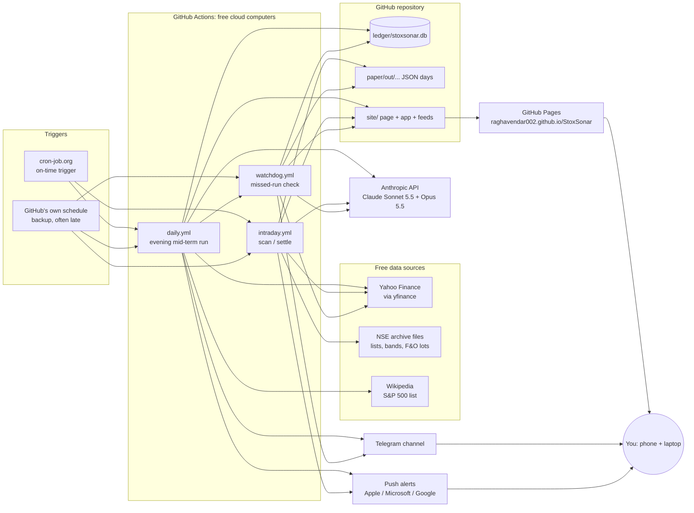
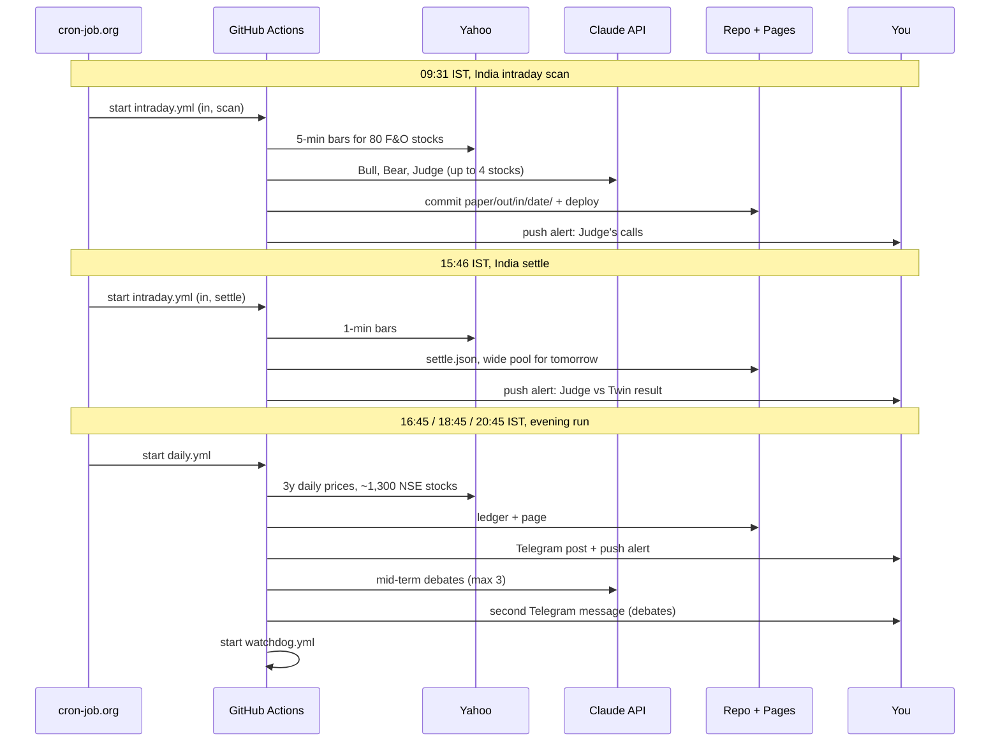
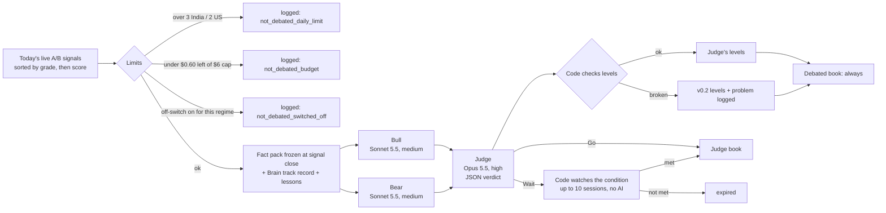
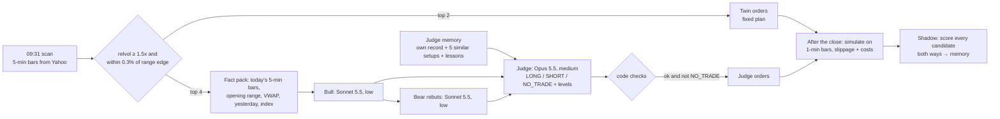
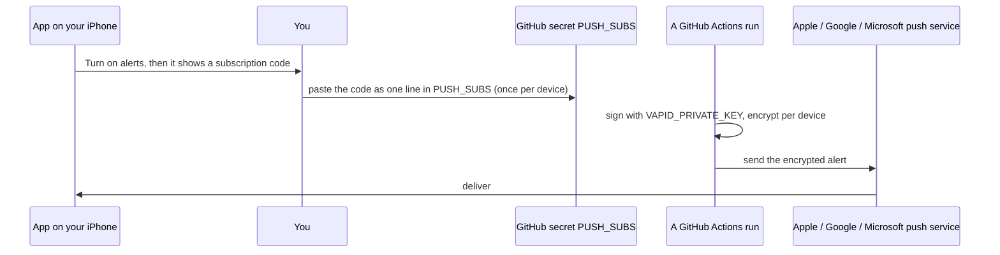

# StoxSonar: how the whole thing works

*Written 22 Nov 2026 from the code on `main` (commit `2519a2b`). Every claim below was checked against the code, the ledger database and the files in the repository, not against memory or old design docs. Where the docs and the code disagree, section 16 says so.*

This guide is for the owner. Each section starts with the plain answer, then gives the technical detail and the file to look at. You can stop reading any section after its first paragraph.

---

## Contents

1. [The 60-second version](#1-the-60-second-version)
2. ["Which LLM do you use?": the short answer](#2-which-llm-do-you-use-the-short-answer)
3. [The big picture (diagram)](#3-the-big-picture)
4. [Where the data comes from](#4-where-the-data-comes-from)
5. [When things run: the schedule](#5-when-things-run-the-schedule)
6. [The v0.2 engine: how a stock gets a grade](#6-the-v02-engine-how-a-stock-gets-a-grade)
7. [The ledger: the permanent record](#7-the-ledger-the-permanent-record)
8. [Mid-term paper books (Raw, Twin, Debated, Judge)](#8-mid-term-paper-books)
9. [Mid-term Bull / Bear / Judge](#9-mid-term-bull--bear--judge)
10. [The mid-term Brain and the off-switch](#10-the-mid-term-brain-and-the-off-switch)
11. [Intraday paper trading (India and US)](#11-intraday-paper-trading)
12. [The intraday Judge's memory](#12-the-intraday-judges-memory)
13. [The missed-run check (watchdog)](#13-the-missed-run-check-watchdog)
14. [What you see: web page, app, alerts, Telegram](#14-what-you-see-web-page-app-alerts-telegram)
15. [Money: API costs, caps and what has been spent](#15-money-api-costs-caps-and-spend)
16. [Documented but not built, and other mismatches](#16-documented-but-not-built-and-other-mismatches)
17. [Secrets and keys](#17-secrets-and-keys)
18. [File-by-file map](#18-file-by-file-map)
19. [Research and one-off workflows](#19-research-and-one-off-workflows)
20. [Where things stand today](#20-where-things-stand-today)
21. [Glossary](#21-glossary)

---

## 1. The 60-second version

StoxSonar is a set of Python scripts that run on GitHub's free computers (GitHub Actions). Nobody's laptop needs to be on. It does three jobs:

1. **Every evening (mid-term, 1–3 month ideas).** It downloads ~3 years of daily prices for every liquid NSE stock, labels each stock (Basing, Advancing, Topping, Declining), spots *breakouts* and *breakdowns*, and grades them A/B/C with fixed rules. This part is plain arithmetic, no AI. It saves every signal to a permanent record, publishes a web page, and posts to Telegram. It then does the same for the S&P 500 (US list).
2. **After that, the AI review.** For the best few signals of the day (Grade A/B, at most 3 for India and 2 for the US), three Claude AI calls hold a debate. A **Bull** argues for the trade, a **Bear** argues against, and a **Judge** rules *Go*, *Wait* or *Avoid* with entry, stop and target prices. Nothing is bought. Every verdict becomes a **paper trade** that is scored later by plain code.
3. **Every market day (intraday, paper only).** 15 minutes after the open, a scanner looks for stocks breaking out of their first 15 minutes on heavy volume. A fixed-rule **Twin** takes the top signals automatically. The same Bull/Bear/Judge trio looks at each one and decides LONG, SHORT or NO_TRADE. After the close, both paper accounts (₹1 lakh India, $1,000 US) are settled on 1-minute price bars, to see whether the Judge beats the Twin.

Everything you see (the web page, the app on your phone, the push alerts) is built from files those scripts commit to the repository. There is no server and no database running anywhere. The "database" is one SQLite file (`ledger/stoxsonar.db`) that lives in the repo and is updated by each run.

**No real money is traded anywhere in this system.** Every trade is on paper.

---

## 2. "Which LLM do you use?": the short answer

**Plain answer you can give anyone:**

> "StoxSonar uses Anthropic's Claude models through the Anthropic API. Claude Sonnet 5.5 plays the Bull and the Bear, and Claude Opus 5.5 plays the Judge and writes the weekly lessons. The stock screening and grading itself uses no AI at all. It's fixed rules on price and volume, and the AI only reviews the shortlist. Every AI verdict is paper-traded and scored by code against a rule-only baseline, so we can tell whether the AI is adding anything."

**The exact facts, from the code:**

| Role | Model ID in code | Where it's set | "Effort" setting |
|---|---|---|---|
| Bull and Bear (mid-term) | `claude-sonnet-5-5` | `sonar/config.py` → `DEBATE_MODEL_ARGUE` | `medium` |
| Judge (mid-term) | `claude-opus-5-5` | `sonar/config.py` → `DEBATE_MODEL_JUDGE` | `high` |
| Bull and Bear (intraday) | `claude-sonnet-5-5` | same constant, used in `paper/intraday.py` | `low` |
| Judge (intraday) | `claude-opus-5-5` | same constant | `medium` |
| Weekly lessons review (mid-term) | `claude-opus-5-5` | `sonar/brain.py` | `high` |
| Weekly lessons review (intraday) | `claude-opus-5-5` | `sonar/intrabrain.py` | `medium` |

```python
# sonar/config.py
DEBATE_MODEL_ARGUE = "claude-sonnet-5-5"   # Bull and Bear
DEBATE_MODEL_JUDGE = "claude-opus-5-5"     # Judge
DEBATE_PRICES = {            # USD per million tokens: (input, output, cache read)
    "claude-sonnet-5-5": (2.0, 10.0, 0.10),
    "claude-opus-5-5": (4.0, 20.0, 0.20),
}
```

Those prices match Anthropic's published rates for these models as of November 2026.

**Follow-up questions people ask, and the honest answers:**

- *"Is it a chatbot / agent?"* No. Each AI call is one request with a fixed prompt and a "fact pack" of numbers. The AI has no tools, no internet and no news. It can't place orders. Python checks its levels and sizes every trade. (`sonar/debate.py`, `api_call`.)
- *"How do you stop it using hindsight?"* The prompts tell it to use only the fact pack and nothing it remembers about later prices. The fact pack is frozen at the signal close. The Brain's track record only includes trades that had already finished before the signal date.
- *"Does the Judge output free text?"* No. It must answer in a fixed JSON format (Anthropic's *structured outputs*, `output_config.format`), so code can read the verdict and levels reliably.
- *"Do you fine-tune or train a model?"* No. The "learning" is a short list of rules of thumb (lessons) written by Opus once a week and checked by code. That only starts once enough paper trades have closed, and none have been written yet.
- *"Which library?"* The official `anthropic` Python SDK (`requirements.txt`: `anthropic>=1.0`), calling the Messages API with prompt caching on the shared fact pack.
- *"What does it cost?"* About 4 US cents per intraday debate and about 10 cents per mid-term debate. Code enforces hard monthly caps: $28 intraday plus $6 mid-term. Spend so far in November is about $1.74 (section 15).
- *"Did you ever use another model?"* The older prototype (the `backend/` folder in the project files, a FastAPI app) had one route that called `claude-haiku-4-5-20251001`. It is not part of this repository and does not run.

---

## 3. The big picture

**Plain version:** a scheduler wakes GitHub up, GitHub runs the scripts, the scripts read free price data, a few results go to Claude for review, and everything gets written back into the repository. GitHub Pages then serves it to your phone.



**The three daily loops, side by side:**

```mermaid
flowchart TB
    subgraph MID[Mid-term, every evening after the NSE close]
        M1[Download 3y daily prices] --> M2[v0.2 engine: stage, template,<br/>breakouts, grade A/B/C]
        M2 --> M3[Save to ledger + publish page<br/>+ Telegram]
        M3 --> M4[Books: turn signals into paper trades,<br/>freeze fact packs]
        M4 --> M5[Bull / Bear / Judge on top A/B<br/>max 3 India, 2 US]
        M5 --> M6[Brain: post-mortems, scoreboard,<br/>weekly lessons]
    end
    subgraph INTRA[Intraday, every market day]
        I1[Open + 15 min: opening-range scan] --> I2[Twin takes top 2 by rule]
        I1 --> I3[Bull / Bear / Judge per stock<br/>max 4 per market]
        I3 --> I4[Judge orders]
        I2 & I4 --> I5[After the close: settle both books<br/>on 1-minute bars]
        I5 --> I6[Shadow-score every candidate<br/>→ Judge memory]
    end
    subgraph WD[Watchdog, three times a day]
        W1[Check all four books ran] --> W2[Repair what's missing<br/>replay / settle / re-run]
        W2 --> W3[Telegram report + paper/health.json]
    end
```



---

## 4. Where the data comes from

**Plain version:** all prices are free. The live system gets its prices from **Yahoo Finance**. NSE's own downloadable files are used for lists (which stocks exist, which are in F&O, price bands) and for long historical backtests. Nothing needs a login, and no Upstox, Alpaca or Bloomberg account is used.

| What | Source | Used by | File |
|---|---|---|---|
| Daily prices, NSE (3 years, split/bonus-adjusted) | Yahoo Finance (`yfinance`, tickers like `RELIANCE.NS`) | evening run | `sonar/data.py` `fetch_prices` |
| Daily prices, S&P 500 | Yahoo Finance | evening US run | same |
| Benchmark | Nifty 500 (`^CRSLDX`), fallback Nifty 50 (`^NSEI`); US: `RSP`, fallback `^GSPC` | regime and relative strength | `sonar/config.py` |
| Volatility index | India VIX (`^INDIAVIX`), US `^VIX` | fact pack only | `data.latest_vix` |
| Results (earnings) dates | Yahoo `Ticker.calendar` (often empty for NSE) | fact pack only | `data.next_results_date` |
| NSE stock list | committed `universe/nse_sec_list.csv` (source: NSE archive) | evening run | `data.load_universe` |
| S&P 500 members | Wikipedia table, saved to `universe/sp500.csv` | US run | `data.load_us_universe` |
| Sectors | committed `universe/sectors_nse.json` | sector stats in fact pack | `data.load_sectors` |
| 5-minute and 1-minute intraday bars | Yahoo Finance | intraday scan and settle | `paper/intraday.py` `bars` |
| Nifty 500 list, price bands, F&O lot list | `nsearchives.nseindia.com` CSVs (no login) | wide intraday pool | `paper/pool.py` |
| NSE daily "bhavcopy" files, 2006 onward | `nsearchives.nseindia.com` | backtests and research only | `sonar/nse.py`, `backtest.py` |

**Why the bhavcopy files aren't used live:** they include delisted stocks (no survivorship bias), which matters for testing history. For the daily run, Yahoo's prices are already adjusted for splits and bonuses, so they are simpler. The code says plainly that Yahoo is a personal-use source and must be replaced with a licensed vendor before StoxSonar charges anyone:

```python
# sonar/data.py
"""Uses Yahoo Finance through yfinance because its NSE history is already split-
and bonus-adjusted, which the spec makes a launch blocker. yfinance is a
personal-use source: fine for a free beta, and it must be swapped for a
licensed vendor behind `fetch_prices` before StoxSonar charges anyone."""
```

**Safety checks on data:**
- A run never uses a half-finished bar. Prices are cut at the last *completed* session (`last_complete_day`).
- If more than 20% of stocks lack today's bar, the run refuses to publish a partial day (`run_daily.py`).
- A one-day move of 50%+ on under 2x normal volume is treated as a bad print (`SPIKE_MAX_MOVE`).
- Yahoo keeps 1-minute bars only about 7 days back. That is why a missed intraday settle has to be repaired within a week.

---

## 5. When things run: the schedule

**Plain version:** GitHub's own timer is unreliable and often starts jobs hours late. So a free website called **cron-job.org** pokes GitHub at exact times, and GitHub's timer stays on as a backup. Every job checks whether its work is already done and exits in seconds if so. That way extra triggers never cause duplicate posts or double API bills.

### Times in IST, Monday to Friday

| What | On-time trigger (cron-job.org) | GitHub backup schedule | Workflow |
|---|---|---|---|
| Evening mid-term (India, then US) | 16:45, 18:45, 20:45 *(per project record)* | 16:17, 17:17, 18:17, 19:17, 20:47, 22:47, and 05:47/06:47/07:47 next morning | `daily.yml` |
| India intraday scan | 09:31 | 09:31 | `intraday.yml` (market=in, mode=scan) |
| India intraday settle + build tomorrow's wide pool | 15:46 | 16:00 | `intraday.yml` (in, settle) |
| US intraday scan | 20:16 (19:16 in US summer time) | 19:16 and 20:16 | `intraday.yml` (us, scan) |
| US intraday settle | 02:42 (Tue–Sat) | 03:45 | `intraday.yml` (us, settle) |
| Missed-run check | after **every** daily.yml run | 17:10, 22:45, 07:15 | `watchdog.yml` |

*The cron-job.org jobs live on cron-job.org, not in this repo, so the times in that column come from the project's records (verified working on 24 Oct and 18 Nov 2026), not from code. The backup times are in the workflow files.*

**The US mid-term list** runs inside the same `daily.yml` run, right after India. The US close lands around 02:30 IST, so in practice only the early-morning attempts find a new US session.



**How a run knows it has nothing to do:**

```python
# run_daily.py
prev = ledger.last_run(con, market)
done = last_complete_day(datetime.now(timezone.utc), market)
if a.mode == "daily" and prev is not None and prev >= done:
    log.info("%s is the newest finished session and is already published", prev)
    return 0
```

```python
# paper/intraday.py — a day that already has orders is never scanned twice
if replay and not force and (OUT / mkt / str(replay) / "orders.json").exists():
    print(f"{cfg['name']} {replay} already scanned; nothing to do", flush=True)
    return None
```

Workflows also share *concurrency groups*. Two intraday triggers, or an intraday run and the watchdog, queue behind each other instead of running at once, so the same debate can't be paid for twice.

---

## 6. The v0.2 engine: how a stock gets a grade

**Plain version:** for each stock the engine asks four questions, using only price and volume. (1) Which **stage** is it in: basing, advancing, topping or declining? (2) How many of 8 **trend-template** checks does it pass? (3) Did it just **break out** of a sideways range on heavy volume, or break down? (4) How strong is its **momentum** compared with past breakouts? That gives Grade A, B or C. In a **Weak** market every bullish grade drops one level and no buys are suggested at all. No AI is involved anywhere in this step.

File: `sonar/engine.py`. Settings: `sonar/config.py` (`ENGINE_VERSION = "0.2.0"`).

### 6.1 Universe
Every NSE EQ-series stock (ETFs removed) with a median traded value of at least **₹1 crore a day** over 20 sessions, and at least 252 sessions of history. The US list uses today's S&P 500.

### 6.2 Stage (Weinstein stages, daily data)

```python
# sonar/engine.py
def raw_stage(row, prev_confirmed):
    c, s50, s150, slope = row.Close, row.sma50, row.sma150, row.slope150
    if c > s150 and slope > C.SLOPE_BAND and s50 > s150:
        return 2          # Advancing
    if c < s150 and slope < -C.SLOPE_BAND and s50 < s150:
        return 4          # Declining
    if -C.SLOPE_BAND <= slope <= C.SLOPE_BAND:
        ...               # flat 150-day average: 1 (Basing) after a decline, 3 (Topping) after an advance
```

`slope150` is the 150-day average against itself 21 sessions ago, and ±1% counts as flat. A new stage only counts after it holds for **5 sessions** (`CONFIRM_SESSIONS`), so labels don't flicker.

### 6.3 Trend template (Minervini, 0–8)
Eight yes/no checks: the averages stacked in the right order, the 200-day average rising, the price at least 30% above its 52-week low and within 25% of its high, and RS rank ≥ 70.

### 6.4 Breakout / breakdown trigger
- A **base**: at least 15 sessions sideways within the last 65, in a range 8–35% deep (up to 50% for very volatile stocks).
- A **breakout**: a close at least **2%** above the top of the range, on at least **1.5x** the 50-day average volume, without a big wick against the move.
- A **breakdown**: a close 0.5% below the bottom of the range, same volume rule.

### 6.5 Grade
**Breakouts** are graded on a momentum score: the plain average of four z-scores (RS rank, 6-month return, distance above the 200-day average, distance above the range). The means and spreads were fixed on 2006–2018 breakouts only.

```python
# sonar/engine.py
def grade_event(direction, stage, score, above_sma200, weak_regime):
    if direction == "up":
        if not above_sma200:
            return "C"
        g = "A" if score >= C.SCORE_A else "B" if score >= C.SCORE_B else "C"   # 0.565 / -0.118
        if weak_regime:
            g = {"A": "B", "B": "C"}.get(g, g)
        return g
    return {3: "A", 4: "B", 2: "W", 1: "C"}[stage]   # breakdowns: by stage
```

`SCORE_A` is the 80th percentile of 2006–2018 breakouts and `SCORE_B` the 50th.

### 6.6 Market regime: Healthy or Weak

```python
# sonar/engine.py (run_market)
regime = pd.DataFrame({"bench_ok": (b > sma200) & (sma200 > sma200.shift(21))})
regime["weak"] = ~(regime["bench_ok"] & (regime["stage2_share"] >= C.REGIME_MIN_STAGE2_SHARE))  # 40%
```

The market is **Healthy** only if the Nifty 500 is above a rising 200-day average **and** at least 40% of stocks are in Stage 2. Otherwise it is **Weak**, and with `NO_LONGS_WHEN_WEAK = True` no buys are suggested.

### 6.7 Shadow grade (logged only)
A second, newer score (near the 52-week high, tight shallow base, low volatility, not stretched) is recorded next to every signal as `shadow_grade`. It changes nothing you see. It beat v0.2 on unseen years but missed the 0.95 deflated-Sharpe bar, so it's being watched on live trades first.

### 6.8 Follow-up (lifecycle)
Each signal is watched for 10 sessions: **Confirmed** if it holds above the breakout level, **Failed** if it closes 2.5 ATR against the entry, plus Extended and Faded. Returns are measured from the **next morning's open** at 5, 21 and 63 sessions, against the benchmark.

### 6.9 Trade plan (`sonar/plan.py`)
For a bullish suggestion: buy at the next open only if it opens within 1 ATR of the signal close. The stop is 2.5 ATR below. Size the position so hitting the stop loses **0.5% of ₹1 lakh = ₹500**, never more than 25% of the account in one stock. Sell at the close 21 sessions later if the stop wasn't hit.

---

## 7. The ledger: the permanent record

**Plain version:** every signal is written once, the day it appears, and never edited. Only its later results get filled in. The database file is committed to GitHub every evening, so git history is a public, time-stamped proof that nothing was added or changed after the fact.

File: `ledger/stoxsonar.db` (SQLite). Code: `sonar/ledger.py`, `sonar/books.py`, `sonar/brain.py`.

| Table | What's in it | Rows today |
|---|---|---|
| `events` | every signal (live and replayed history), grade, outcomes | 2,887 |
| `stage_daily` | each stock's stage per day | 41,441 |
| `runs` | one row per published session, with regime | 35 |
| `mt_picks` | mid-term paper trades in all four books | ~45 |
| `mt_facts` | frozen fact packs the debates read | 4 |
| `mt_debates` | every Bull/Bear/Judge exchange, verdict, cost | 4 |
| `mt_outcomes` | post-mortems of closed judged trades | 1 |
| `mt_lessons` / `mt_reviews` | Brain lessons and the reviews that wrote them | 0 / 0 |

Every signal carries a `source`: `live` (seen on the day), `replay` (rebuilt from history when a new engine version started) or `late`. The track record is only reported per engine version.

---

## 8. Mid-term paper books

**Plain version:** to know whether the AI Judge adds anything, you need something to compare it with. So every signal is paper-traded four ways at once, all scored by the same fixed rules on daily prices, after costs.

| Book | What it trades | What it tells you |
|---|---|---|
| **Raw v0.2** | what v0.2 actually suggests: A/B breakouts, none in a Weak market | how the app's own advice does |
| **Twin** | *every* candidate (C grades too, plus breakdowns as shadow shorts), no market filter, always filled at the next open | "take every pick", the baseline |
| **Debated** | every stock the Judge ruled on, whatever the verdict, at the Judge's levels | how Go, Wait and Avoid each turned out |
| **Judge** | only Go picks, plus Wait picks from the day their condition is met | what following the Judge would have earned |

File: `sonar/books.py`. Exit rules, checked bar by bar from the day after the signal:
- entry at the next open;
- **stop**: exit at the stop, or at the open if the stock gapped through it (gaps fill worse);
- **target**, if set: exit there. A bar touching both stop and target counts as the stop (the cautious assumption);
- **time**: the close `horizon` sessions after the signal (21 or 63).

A pick's identity and levels are written once and never change. Results are in **R** (profit divided by the planned risk) and against the index, after Indian costs.

---

## 9. Mid-term Bull / Bear / Judge

**Plain version:** after the evening's signals have already gone out (so a slow or failed AI step can never delay them), the top A/B signals each get a three-way review. The Bull and Bear each write under 280 words from the same fact pack. The Judge reads both and gives a verdict in a fixed JSON format. Then **code** checks the Judge's prices. If they break the rules (for example a stop that's too far away), the trade falls back to v0.2's own levels and the problem is logged.

File: `sonar/debate.py`. Called from `run_daily.py` → `run_debates`.



### 9.1 What the AI is told (excerpts)

```python
# sonar/debate.py
SYSTEM = (
    "You are one voice in a three-part review of a stock signal for a small Indian retail account "
    "(Rs 1 lakh, risk 0.5% per trade, holding one to three months, delivery only). A rule-based "
    "screen has flagged the stock. That screen has NOT yet proved it makes money, so its grade is a "
    "starting point, not evidence. Work only from the fact pack in the message ... You have no "
    "news, no fundamentals and no knowledge of what happened after the signal date ...")

JUDGE = (
    "You are the Judge. ... Go: act at the next open inside your entry zone. "
    "Wait: ... Give ONE condition code can check on daily bars ... Avoid: the risk is not worth it.\n"
    "Most signals from this screen have not paid, so Go needs a reason the Bear could not answer, "
    "and Avoid is a normal, respectable verdict. When the market regime is Weak, a long needs more. ...")
```

For the US list, the account line is swapped for "a small US cash account ($1,000 ... long only)".

### 9.2 The actual API call

```python
# sonar/debate.py
def api_call(model, shared, instruction, effort, schema=None, system=None):
    import anthropic
    client = anthropic.Anthropic()                    # reads ANTHROPIC_API_KEY
    out_cfg = {"effort": effort}
    if schema is not None:
        out_cfg["format"] = {"type": "json_schema", "schema": schema}   # Judge only
    r = client.messages.create(
        model=model, max_tokens=12000, system=system or SYSTEM, output_config=out_cfg,
        messages=[{"role": "user", "content": [
            {"type": "text", "text": shared, "cache_control": {"type": "ephemeral"}},  # fact pack, cached
            {"type": "text", "text": instruction}]}])
    if r.stop_reason == "refusal":
        raise Refused(f"{model} declined")
    ...
    return Reply(text, tokens_in, u.output_tokens or 0, cost_usd(model, u))
```

The fact pack goes first and is **cached**, so the Bear's and the Judge's calls re-read it at about a tenth of the price. The cost of every reply is worked out from the API's own token counts.

### 9.3 The Judge's verdict format (JSON schema, abridged)

```text
verdict: Go | Wait | Avoid          conviction: 1–5          horizon_sessions: 21 or 63
entry_low, entry_high, stop, target, target_2
wait_kind: none | close_above | close_below, wait_level, wait_min_volume_ratio, wait_within_sessions
invalidation, how_its_moving (plain sentences), reasons_for[], reasons_against[]
```

### 9.4 The rules code enforces on the Judge's prices

```python
# sonar/debate.py check_levels / sonar/config.py
JUDGE_ENTRY_MAX_ATR = 1.0    # the entry zone must sit within 1 ATR of the signal close
JUDGE_STOP_MAX_ATR = 3.0     # the stop at most 3 ATR from the entry
JUDGE_TARGET_MIN_R = 1.5     # the first target at least 1.5R away
```

Breakdowns are **shadow shorts**: scored, never sized, because an Indian cash account can't hold a short overnight.

### 9.5 Telegram
The debates go out as a **second** Telegram message after the day's signals, so v0.2's message is never delayed. The page `site/debates.html` shows every debate in full.

---

## 10. The mid-term Brain and the off-switch

**Plain version:** the Brain is the system's memory. Before each debate, plain code looks up how similar past signals ended and hands that to all three AI voices as a "track record". After trades close, code scores whether each verdict was right. Once at least 8 judged trades have closed, Opus may write a few short rules of thumb ("lessons") once a week, and code only keeps a lesson that cites real cases and names no stocks. The **off-switch** stops paying for debates in a market type where the Judge just says Avoid to everything.

File: `sonar/brain.py`. Settings in `sonar/config.py`.

The Brain has four jobs, and only the last uses AI:

1. **Track record (code).** How the screen's earlier signals of this side and grade ended, the 25 most similar past signals, and the Judge's own past verdicts. Only results finished **before** the signal date are used.
2. **Post-mortems (code).** When a judged trade closes, record whether the verdict was right (`mt_outcomes`).
3. **Scoreboard (code).** Progress against the pass test, fixed in advance: at **100** judged trades, Go must beat Avoid with a bootstrap 90% interval above zero, the Judge book must beat the Twin after costs **and** API fees, and conviction 4–5 must beat 1–2. If it is still failing at **150**, it gets killed.
4. **Lessons (Opus, at most weekly).** These need at least 8 closed judged trades, a lesson must cite 8+ cases and name no stock, at most 12 lessons are active and at most 3 are added per review, and every change is versioned.

```python
# sonar/config.py
BRAIN_MIN_CASES = 8; BRAIN_MAX_LESSONS = 12; BRAIN_MAX_ADD = 3
BRAIN_REVIEW_EVERY_DAYS = 7; BRAIN_REVIEW_MIN_NEW = 4
BRAIN_TEST_AT = 100; BRAIN_KILL_AT = 150
```

India and US each have their own Brain. Lessons never mix between markets.

### The off-switch

```python
# sonar/debate.py
def switched_off(con, market, regime):
    """After the first DEBATE_OFF_AFTER (20) verdicts in a market regime, if fewer than
    DEBATE_OFF_MIN_ACT_SHARE (10%) of them were Go or Wait, the Judge is adding
    nothing over "skip every signal", so debates in that regime stop. ..."""
```

The switch is counted **per regime** (Weak vs Healthy). A Judge switched off in Weak markets starts fresh when the market turns Healthy. Once it's on it stays on, until someone changes the setting. The books keep scoring either way.

---

## 11. Intraday paper trading

**Plain version:** every market day, 15 minutes after the open, a scanner checks a list of liquid stocks. A stock is a signal if its first-15-minute volume is at least 1.5x normal and its price is within 0.3% of the top (or bottom) of its first 15 minutes. The fixed-rule **Twin** buys the top two automatically. The **Judge**, after hearing a Bull (always argues long) and a Bear (rebuts, argues short or stay out), decides per stock. Orders are "stop entries": they only fill if the price actually trades through the trigger later. After the close, the day is replayed minute by minute to see what each book made, after brokerage and taxes.

File: `paper/intraday.py`. Workflow: `.github/workflows/intraday.yml`.

### 11.1 The two accounts

| | India | US |
|---|---|---|
| Money | ₹1,00,000 | $1,000 |
| Risk per trade | ₹500 (0.5%) | $5 (0.5%) |
| Sides | long and short (intraday MIS) | long only (cash account; a SHORT verdict is logged, not traded) |
| Stock list | 80 liquid F&O names (Nifty 50 + active Next 50) | ~100 large US names |
| Entries allowed until | 14:00 | 14:30 New York |
| Everything closed by | 15:15 | 15:50 New York |
| Leverage | Judge conviction 4–5 → up to 2x position size (risk stays ₹500) | none |
| Positions per book | 2 | 2 |
| Debates per day | up to 4 | up to 4 |

### 11.2 The scanner rule

```python
# paper/intraday.py
def _signals(df, can_short):
    """The scanner's rule: opening volume >= 1.5x normal and price within 0.3% of the range edge."""
    longs = df[(df.relvol >= 1.5) & (df.dist_or_hi >= -0.003)].assign(side="long")
    shorts = df[(df.relvol >= 1.5) & (df.dist_or_lo <= 0.003) & can_short].assign(side="short")
```

Normal volume is the average first-15-minute volume over the last 20 sessions. Signals are ranked by relative volume.

### 11.3 The Twin's fixed plan (the baseline)

```python
# paper/intraday.py make_cands
trig = max(r.or_hi, r.last) * 1.0005             # just above the opening-range high
stop = max(r.or_lo, trig - 1.5 * atr * 2)         # range low, or ~3 five-minute ATRs
tgt  = trig + 2 * (trig - stop)                   # 2R target
```

### 11.4 The Judge's rules (checked by code)
The trigger must sit within 0.6% of the last price, the stop 0.15–2% from the trigger on the losing side, and the target at least 1.5x the stop distance. A SHORT outside F&O, or any SHORT in the US, is logged but not traded.



### 11.5 Settling on 1-minute bars

```python
# paper/intraday.py simulate (abridged)
for ts, r in b.iterrows():
    if entry is None:
        if ts.strftime("%H:%M") > o["latest_entry"]:
            return dict(status="not_triggered")
        hit = r.High >= trig if up else r.Low <= trig
        ...                                    # fill at trigger (or the open if it gapped past), plus slippage
    if stop hit:   exit at stop (or worse open)
    if target hit: exit at target
# still open at the cutoff → exit at the last close ("time")
```

Indian costs are modelled in full: brokerage ₹20 or 0.03%, STT, exchange fee, SEBI fee, stamp duty and GST. That comes to about ₹130 per round trip on a typical trade. US costs are the SEC fee plus FINRA TAF. Slippage is 0.05% India and 0.02% US, and higher for thinner stocks in the wide pool.

### 11.6 Late or missed runs
If a scan starts more than 30 minutes after the open, it **replays** the open from that day's 5-minute bars, cut at the checkpoint. The Judge sees exactly what an on-time run would have seen, and orders start 2 minutes after the checkpoint. The day is marked `replayed`.

### 11.7 The wide India pool (built, running in "shadow")
Since 18 Nov a second, wider list is built each evening after the India settle (`paper/pool.py`): Nifty 500 stocks in the EQ series, a price band of 10% or more, price ≥ ₹50, and median turnover ≥ ₹10 crore a day. Shorts are allowed only on F&O names. Right now it runs in **shadow mode** (`INTRA_WIDE` defaults to `"shadow"`). It is scanned and its own rule twin is logged, but the debates still use the 80-stock list. Switching it live is a one-line setting.

### 11.8 Files for one day
`paper/out/<in|us>/<date>/`: `scan.json` (candidates and bars), `debates.json` (Bull, Bear, Judge texts, verdict, cost, memory), `orders.json` (Twin and Judge orders), `settle.json` (both books, the shadow scores and the pool test).

---

## 12. The intraday Judge's memory

**Plain version:** after each close, code scores *every* candidate twice, whether or not anyone traded it: once with the Twin's rule plan and once with the Judge's own prices (even a NO_TRADE names the prices it would have used). So when the Judge says "no trade", we still find out whether that was right. Before each new decision, the Judge (not the Bull or Bear, to keep the bill small) gets a ~150-word note: its record so far, how the rule plan has done, and the 5 most similar past setups. After 20 scored calls, Opus can write lessons once a week.

File: `sonar/intrabrain.py`.

- **Refusal scoring.** A NO_TRADE is *right* if the rule trade lost at least 0.1R, *wrong* if it made at least 0.1R, and *flat* in between.
- **Similarity** uses relative volume, the gap, the move so far, the distance from VWAP and the index move.
- **Lessons**: none before 20 scored calls and 10 new ones, at most weekly, at least $1 of the intraday cap left, 8 cited cases per lesson, no names or dates, max 8 lessons. Stored in `paper/brain/<mkt>.json`. **That folder doesn't exist yet**, because no review has run.

The shape of what the Judge receives (numbers here are illustrative, not real):

```text
YOUR TRACK RECORD (India intraday, scored by code after each close; R is the result over the stop
distance after costs. Under about 30 cases every figure is weak evidence: quote the n ...)
Calls so far: 14. Trades you took: 4 (...). No-trade calls: 10 (... right because the rule trade lost ...)
Most similar past long setups:
- relvol 2.1x, gap +0.4%, today +0.9%, vs VWAP +0.3%, index +0.2%: you said NO_TRADE (conv 3); rule plan +0.67R ...
```

---

## 13. The missed-run check (watchdog)

**Plain version:** with four books running (India and US, intraday and mid-term), something will occasionally be missed. The watchdog runs after every evening run and three more times a day. It works out from the files alone what should have happened in the last week, fixes what it can, and tells Telegram.

File: `sonar/watchdog.py`. Workflow: `watchdog.yml`.

Repairs, each tried at most twice per day and category:
- an intraday scan that never ran → replay it as of the checkpoint, then settle it;
- an intraday day never settled → settle it (1-minute bars last ~7 days);
- an evening run that never went through → start `daily.yml` again;
- mid-term candidates never debated → debate them.

The result goes to `paper/health.json`, which the app's Brain tab shows. It also reports failed GitHub runs it hasn't reported yet.

---

## 14. What you see: web page, app, alerts, Telegram

**Plain version:** there are four places results show up. All of them are built from the same files.

| Where | What | Built by |
|---|---|---|
| **Public page** `raghavendar002.github.io/StoxSonar/` | market mood, today's A/B breakouts and breakdowns, signals in play, track record. No raw prices; symbols link to TradingView | `sonar/publish.py` → `site/index.html`, `data.json`, `ledger.csv`, `books.csv`, `debates.html`, `brain.html` |
| **The app** `…/StoxSonar/app/` | everything: India/US × Mid-term/Intraday, 6 tabs | `site/app/` (static HTML + JS) reading `site/app/feed/*.json` from `sonar/appfeed.py` |
| **Push alerts** to your phone and laptop | evening summary, intraday calls after the scan, results after the settle | `sonar/push.py` |
| **Telegram** (private channel) | evening signals, a second message with the debates, US list, watchdog reports | `sonar/publish.py`, `sonar/watchdog.py` |

### 14.1 The app
It's an installable web app (a "PWA"): open it in Safari, then Share → Add to Home Screen. There is no App Store and nothing to re-sign. It's plain JavaScript modules in `site/app/js/`, with no framework and no build step.

| Tab | Shows |
|---|---|
| Today | market mood and new signals (mid-term), or the day's scan with Judge vs Twin (intraday) |
| Trades | open signals and paper books, or every intraday paper trade |
| Debates | every Bull/Bear/Judge exchange; tap one for the chart, both sides and the ruling |
| Brain | the Judge's scoreboard, lessons, pass test, health of the four books |
| Simulator | replay a past week. **Not working yet, see section 16** |
| More | alerts setup, simulator token, light/dark, track record |

`site/app/sw.js` (the service worker) keeps the app shell offline, always tries the network first for data, and receives push alerts.

### 14.2 How push works without a server



The encryption (RFC 8291) and signing (RFC 8292) are written by hand in `sonar/push.py` using the `cryptography` package. If a device's subscription is reported gone, the run posts a Telegram warning.

---

## 15. Money: API costs, caps and spend

**Plain version:** GitHub, Yahoo, NSE files, Pages, Telegram and cron-job.org are all free. The only bill is the **Anthropic API** (pay per use, separate from any Claude subscription). Code enforces two hard monthly caps that together keep the total under **$34**, within the ~$40 budget.

| | Intraday | Mid-term (India + US share it) |
|---|---|---|
| Monthly cap (in code) | **$28.00** (`MONTHLY_CAP_USD`, `paper/intraday.py`) | **$6.00** (`DEBATE_MONTHLY_CAP_USD`, `sonar/config.py`) |
| Stops debating when less than this is left | $0.25 | $0.60 |
| Where spend is recorded | `paper/spend.json` | `cost_usd` in `mt_debates` + `mt_reviews` |
| Actual cost per debate (Nov 2026) | $0.034–0.051, typically ~$0.04 | ~$0.10 |
| Spent so far in November | **$1.33** | **$0.41** (4 debates) |

Weekly lessons reviews draw from the same caps. When a cap is hit, debates stop until the next month, and everything else (signals, books, Twin) keeps running.

**Why it costs less than first estimated:** the design estimate was ~$0.13 per intraday candidate. Actual is ~$0.04, because the fact pack is cached and the intraday Bull and Bear run at low effort.

At the current rate (about 32 intraday debates a week across both markets, ~$0.04 each), intraday costs about $6 a month, far below its $28 cap.

---

## 16. Documented but not built, and other mismatches

These are the places where a doc, the app, or an earlier plan says one thing and the code does another.

| # | What is claimed | What the code actually does |
|---|---|---|
| 1 | The app's **Simulator** replays a past week via `replay.yml` | `replay.yml` **does not exist**. The Simulator screen and its token check are built, but the replay engine was never merged (it was parked). The buttons stay disabled. |
| 2 | `README.md`: the US list runs "with no page, no debates and no suggestions" | The US list **is debated**: up to 2 a day inside the shared $6 cap (`DEBATE_MAX_PER_DAY_BY_MARKET = {"NSE": 3, "US": 2}`). One US debate has run so far (Avoid). |
| 3 | Project notes: "NSE daily files, no Upstox needed" (read as the live data source) | The **live** system uses **Yahoo Finance** for every price. NSE bhavcopy files are used only by `backtest.py` and research. NSE CSVs are used live only for the wide pool's lists. |
| 4 | `docs/GUIDE.md`: cron-job.org at 16:45, 18:00 and 20:00 | Project records say the jobs were set at 16:45, 18:45 and 20:45. cron-job.org isn't in the repo, so check it there. |
| 5 | Lessons / "the Brain learns" | **No lessons exist yet**, in any market. Mid-term needs 8 closed judged trades (1 so far). Intraday needs 20 scored calls. `paper/brain/` hasn't been created. |
| 6 | Intraday design doc: up to 6 debates per market | Code: **4** (`INTRA_MAX_DEBATE`, default 4). |
| 7 | Intraday design doc: US data from an Alpaca paper account | No Alpaca. US intraday prices come from **Yahoo** (free, a few minutes late). |
| 8 | Wide India pool "rolls out" | Built and scanned daily, but in **shadow** mode only. Debates still use the 80 F&O names. |
| 9 | Push alerts to your iPhone | Code and workflow steps exist and skip quietly until `VAPID_PRIVATE_KEY` and `PUSH_SUBS` are set. **Nobody has confirmed that an alert reached your phone.** Code can't show whether the secrets are set. |
| 10 | Intraday results on Telegram | Intraday runs send **push alerts only**, not Telegram. Telegram gets intraday news only through the watchdog. |
| 11 | Refusals | If Claude declines a request (`stop_reason == "refusal"`), the debate is logged as `refused` and skipped. There is no automatic fallback to another model. |
| 12 | "v0.2 suggests buys" | The NSE market has been **Weak on all 29 live sessions recorded**, so Raw v0.2 has suggested **zero** live buys. The Twin and Debated books carry all the evidence so far. |

---

## 17. Secrets and keys

**Plain version:** secrets are stored in GitHub (Settings → Secrets and variables → Actions). They are never in the code and never printed in logs. Each one switches a feature on. If a secret is missing, that feature quietly skips.

| Secret | Switches on | Used in |
|---|---|---|
| `ANTHROPIC_API_KEY` | every Bull/Bear/Judge debate and lessons review | `daily.yml`, `intraday.yml`, `watchdog.yml` |
| `TELEGRAM_BOT_TOKEN`, `TELEGRAM_CHAT_ID` | Telegram posts | `daily.yml`, `watchdog.yml`, push-failure warnings |
| `VAPID_PRIVATE_KEY` | signing push alerts (public half in `site/app/vapid.json`) | `daily.yml`, `intraday.yml`, `push-test.yml` |
| `PUSH_SUBS` | which devices get alerts (one line per device) | same |
| `GITHUB_TOKEN` | automatic, created by GitHub per run: commits, re-starting runs | all workflows |

Outside GitHub:
- **cron-job.org** holds a fine-grained GitHub token that can only start workflows in this repo (Actions: read and write).
- The app's **Simulator** stores its own token in your browser's local storage, never in the repo.

The public repository contains no secrets. Its results are public on purpose: the dated git history is the proof that the track record wasn't edited after the fact.

---

## 18. File-by-file map

### Entry points (what the workflows actually run)

| File | One-line job |
|---|---|
| `run_daily.py` | the evening run: prices → engine → ledger → page → Telegram → books → debates |
| `paper/intraday.py` | intraday `scan`, `settle` and `pool` commands |
| `python -m sonar.appfeed` | builds the app's JSON feeds after every run |
| `python -m sonar.push` | sends push alerts (`daily`, `intraday`, `test`, `keygen`) |
| `python -m sonar.watchdog` | the missed-run check and repairs |
| `backtest.py` | long-history backtest; never touches the live ledger |

### The `sonar/` package

| File | Lines | What it does |
|---|---|---|
| `config.py` | 132 | every rule setting, the model IDs, prices and caps |
| `data.py` | 196 | Yahoo downloads, stock lists, benchmark, VIX, results dates, sectors |
| `nse.py` | 180 | NSE bhavcopy download, parsing and split/bonus adjustment (backtests) |
| `engine.py` | 494 | stages, trend template, RS rank, breakout detection, grades, regime, lifecycle |
| `plan.py` | 41 | position size, buy ceiling, stop, sell-by date |
| `ledger.py` | 154 | append-only signal record and per-grade track record |
| `books.py` | 362 | the four mid-term paper books, fact packs, sector stats, scoring |
| `debate.py` | 494 | mid-term Bull/Bear/Judge, the API call, cost meter, cap, level checks, Waits, off-switch |
| `brain.py` | 502 | mid-term track record, post-mortems, scoreboard, lessons review |
| `intrabrain.py` | 385 | intraday Judge memory, refusal scoring, lessons review |
| `portfolio.py` | 221 | day-by-day replay of one ₹1L account trading the signals (research) |
| `publish.py` | 614 | public page, debates and Brain pages, all Telegram messages |
| `appfeed.py` | 624 | turns everything into the app's five JSON feeds |
| `push.py` | 287 | web push: encryption, VAPID signing, messages |
| `watchdog.py` | 372 | checks all four books, repairs, reports |

### Other folders

| Path | What |
|---|---|
| `paper/pool.py` | builds the wide India intraday pool each evening |
| `paper/out/<mkt>/<date>/` | one folder per intraday day (scan, debates, orders, settle) |
| `paper/spend.json` | intraday API spend per month |
| `paper/health.json` | the watchdog's latest result |
| `ledger/stoxsonar.db` | the SQLite record (section 7) |
| `site/` | the public page, dated snapshots, and `site/app/` (the app) |
| `universe/` | stock lists: NSE, Nifty 500, F&O lots, S&P 500, sectors |
| `reports/` | backtest, re-tune, simulation and check reports |
| `research/` | one-off studies (re-tune, simulation, gap analysis) |
| `tests/` | 13 test files; `daily.yml` runs them before every evening run |
| `checks/request.txt` | editing this on a `claude/` branch runs `midterm-check.yml` on a copy of the ledger |

---

## 19. Research and one-off workflows

These don't run on a schedule. They were used to test ideas and are started by hand.

| Workflow | What it did |
|---|---|
| `backtest.yml` | runs `backtest.py`: grades replayed back to 2006 |
| `phase2-gate.yml` | checked GitHub's computers can reach NSE's old and new daily files |
| `phase3-retune.yml` | the walk-forward grade re-tune (result: v0.2 stays, shadow grade logged) |
| `phase5-sim.yml` | the ₹1L account simulation (`sonar/portfolio.py`) |
| `midterm-check.yml` | dry-runs the books and a debate on a ledger copy, writes `reports/midterm_check.md` |
| `push-test.yml` | sends one test push alert |

Key research results, recorded in `reports/`:
- The v0.2 ₹1L simulation, Apr 2019 to now: **−0.9%/year vs Nifty 500 +11.1%/year**, with about 90% of the account sitting idle in cash.
- None of the alternative exits tested passed the bar.

This is why everything is still on paper.

---

## 20. Where things stand today

*From the files in the repo on 22 Nov 2026. These are first-week numbers. They mean nothing statistically yet. The pass tests need 100–150 trades.*

**Intraday, week 1 (16–20 Nov), paper P&L per day after costs:**

| Day | India Twin | India Judge | US Twin | US Judge |
|---|---|---|---|---|
| Mon 16 | +₹335 | ₹0 (no trades) | +$2.51 | $0 |
| Tue 17 | +₹91 | +₹332 (CANBK) | −$4.85 | −$0.01 |
| Wed 18 | −₹530 | +₹255 (INDUSINDBK short) | −$1.40 | $0 |
| Thu 19 | +₹308 | +₹317 (BANKBARODA) | −$4.21 | $0 |
| Fri 20 | −₹265 | −₹595 | −$3.29 | $0 |
| **Week** | **−₹62** | **+₹310** | **−$11.24** | **−$0.01** |

In the US the Judge said NO_TRADE on 12 of 14 calls. Its two LONG calls on Tuesday barely moved.

**Mid-term:** 4 debates so far (3 India, 1 US), all **Avoid**. Every India session has been a Weak market.

**Spend:** ~$1.74 of the $34 monthly caps.

---

## 21. Glossary

| Term | Meaning |
|---|---|
| **ATR** | Average True Range: how much a stock typically moves in a day (or in a 5-minute bar for intraday). Used to set stops that fit the stock. |
| **Base** | A sideways stretch before a breakout: at least 15 sessions in a range 8–35% deep. |
| **Benchmark** | The index results are compared with: Nifty 500 for India, the equal-weight S&P 500 (RSP) for the US. |
| **Bhavcopy** | NSE's official end-of-day price file for every stock. |
| **Book** | A paper account that trades by one set of rules (Raw, Twin, Debated, Judge). |
| **Bootstrap 90% interval** | A way to check a difference isn't luck: resample the trades many times and see if the difference stays above zero 90% of the time. |
| **Breakout / breakdown** | A close above the top of a base on heavy volume (bullish), or below its bottom (bearish). |
| **Brain** | The memory layer: track record, post-mortems, scoreboard, lessons. |
| **Cap** | A hard monthly dollar limit on API spend, enforced in code. |
| **Checkpoint** | Open + 15 minutes: the moment the intraday scan "sees" the market. |
| **Conviction** | The Judge's own 1–5 confidence in its verdict. Intraday, 4–5 allows 2x leverage. |
| **cron-job.org** | A free website that calls GitHub at exact times to start the workflows. |
| **Deflated Sharpe** | A Sharpe ratio corrected for how many variants were tried. The bar used here is 0.95. |
| **Effort** | An Anthropic API setting (low/medium/high) for how hard the model thinks: more effort costs more tokens. |
| **F&O** | Futures & Options. Only F&O stocks can be shorted intraday in this system. |
| **Fact pack** | The frozen bundle of numbers every AI voice reads. Nothing after the signal is in it. |
| **GitHub Actions** | GitHub's free computers that run the workflows. |
| **GitHub Pages** | GitHub's free web hosting that serves the page and the app. |
| **Go / Wait / Avoid** | The mid-term Judge's verdicts. Wait comes with a condition that code checks for up to 10 sessions. |
| **LONG / SHORT / NO_TRADE** | The intraday Judge's verdicts. |
| **Ledger** | The append-only signal record, `ledger/stoxsonar.db`. |
| **Lesson** | A short rule of thumb Opus proposes weekly, kept only if code finds it backed by 8+ real cases. |
| **MIS** | Margin Intraday Square-off: an Indian intraday order type, closed the same day. |
| **Off-switch** | Stops mid-term debates in a regime where 20 verdicts gave fewer than 10% Go/Wait. |
| **Opening range (ORB)** | The high and low of the first 15 minutes. An ORB is a break of that range. |
| **Paper trade** | A simulated trade. No money moves. |
| **Prompt caching** | An Anthropic API feature: repeated text (the fact pack) is billed at ~10% on re-reads. |
| **PWA** | Progressive Web App: a website you install to your home screen like an app. |
| **R** | Profit or loss divided by the planned risk. +2R means twice what you risked. |
| **Regime** | Healthy (index above a rising 200-day average and ≥40% of stocks in Stage 2) or Weak. |
| **Relative volume (relvol)** | Today's first-15-minute volume divided by its 20-day normal. |
| **RS rank** | Relative strength percentile (1–99) against all liquid stocks. |
| **Shadow** | Recorded and scored, but changes nothing you see (shadow grade, shadow shorts, shadow pool, shadow scoring). |
| **Stage 1–4** | Basing, Advancing, Topping, Declining (Weinstein's stage analysis). |
| **Structured output** | Forcing the model to reply in an exact JSON shape so code can read it. |
| **Trend template** | Minervini's 8 yes/no trend checks, scored 0–8. |
| **Twin** | The fixed-rule baseline that takes every signal. The Judge must beat it to be worth paying for. |
| **v0.2** | The current version of the grading rules (`ENGINE_VERSION = "0.2.0"`). |
| **VAPID** | The key pair that lets push services trust that alerts come from StoxSonar. |
| **VWAP** | Volume-weighted average price for the day so far. |
| **Watchdog** | The missed-run check. |
| **Wide pool** | The larger Nifty 500 intraday list, currently in shadow mode. |
| **yfinance** | The free, unofficial Python library that reads Yahoo Finance. |
